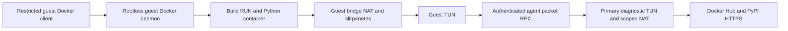

# Online Python builds in a multikernel Docker guest

The approved online diagnostic profile extends the
[offline Docker guest](docker-in-docker-guests.md) with outbound DNS and HTTPS.
The [small Python example](../../../examples/guest-python-online/README.md)
uses the official Docker Hub `python:3.13-slim` base and installs `requests`
and its dependencies from PyPI. Inside the prepared guest, user commands remain:

```sh
cd /online-app
docker build -t guest-python-online .
docker run --rm guest-python-online
```

No user privileged/capability/security flags, host Docker socket, proxy settings,
or Docker endpoint export are required. The approved platform bootstrap supplies
networking and the guest-local rootless Docker daemon automatically. This remains
a diagnostic image profile, pending production shim integration.

## Network path



The diagnostic controller uses the unchanged production agent's
`ConfigureNetwork` and `ExchangeNetwork` operations on its authenticated stream.
The pinned VSOCK transport requires packet traffic to share that stream with
lifecycle and process-output operations. The primary performs scoped forwarding
and NAT; this diagnostic does not requalify the full mknetd/CNI service path.

RootlessKit uses `slirp4netns`, with host-loopback access disabled. The guest
bootstrap loads the pinned bridge/veth and legacy netfilter dependencies before
accepting workloads. The helper's bootstrap TUN device is owned by guest UID/GID
1000 with mode 0600; it is absent from the workload device projection. A narrow
ip-only nsenter wrapper avoids BusyBox's substitution of its minimal ip applet.
Bootstrap supplies the hosts and resolver files needed for networking.

The primary fixture permits outbound TCP 443 and UDP DNS to 8.8.8.8, rejects
listed private/link-local destinations, drops traffic to primary local services,
and allows established return traffic. These are retained fixture rules, not
proof of a complete adversarial network-policy matrix. There is no TCP Docker
API listener or access to the primary Docker socket.

## Evidence and scope

The [online evidence bundle](../../../evidence/runtime-20261012/g7-dind-online/README.md)
records a passed online run and frozen-source rerun, including Python 3.13.16,
Requests 2.34.2, and an HTTPS 200 response. Wheel hashes match separately
collected version-specific public PyPI metadata.

The live test starts with an empty Docker image store, pulls the Python base
inside the guest, records its resolved repository digest, and checks that
`requests` is absent from the base. The build uses `--no-cache-dir` and the
explicit HTTPS PyPI index. Pip's JSON report records wheel URLs, SHA256 digests,
package versions and installation metadata. The app imports the installed
package and fetches public PyPI metadata with `verify=True`. A repeat build
checks Docker's cache. Receipts include daemon/client/nested authority and
cleanup, and failed attempts are retained rather than rewritten.

The outer client remains guest UID 0 with zero effective/bounding capabilities
and NNP=1. The rootless daemon maps namespace root to guest UID/GID 1000 and
inherits NNP. Nested containers use Docker's namespace-local default capabilities
and seccomp; these observations do not prove guest-kernel containment.

VFS/classic image storage is used. Persistence, daemon restart, concurrency,
published ports, IPv6, resource-limit enforcement, production mediated storage,
full CNI lifecycle and independent service/socket review remain unqualified.
The daemon reports no cgroup driver, so CPU/memory/pid limit enforcement is not
established. The G7 architectural limitation after child-kernel compromise and
the absence of a matched gVisor comparison remain unchanged.

Upstream references: [official Python image](https://hub.docker.com/_/python),
[Requests on PyPI](https://pypi.org/project/requests/2.34.2/), and
[RootlessKit networking](https://github.com/rootless-containers/rootlesskit/blob/master/docs/network.md).
