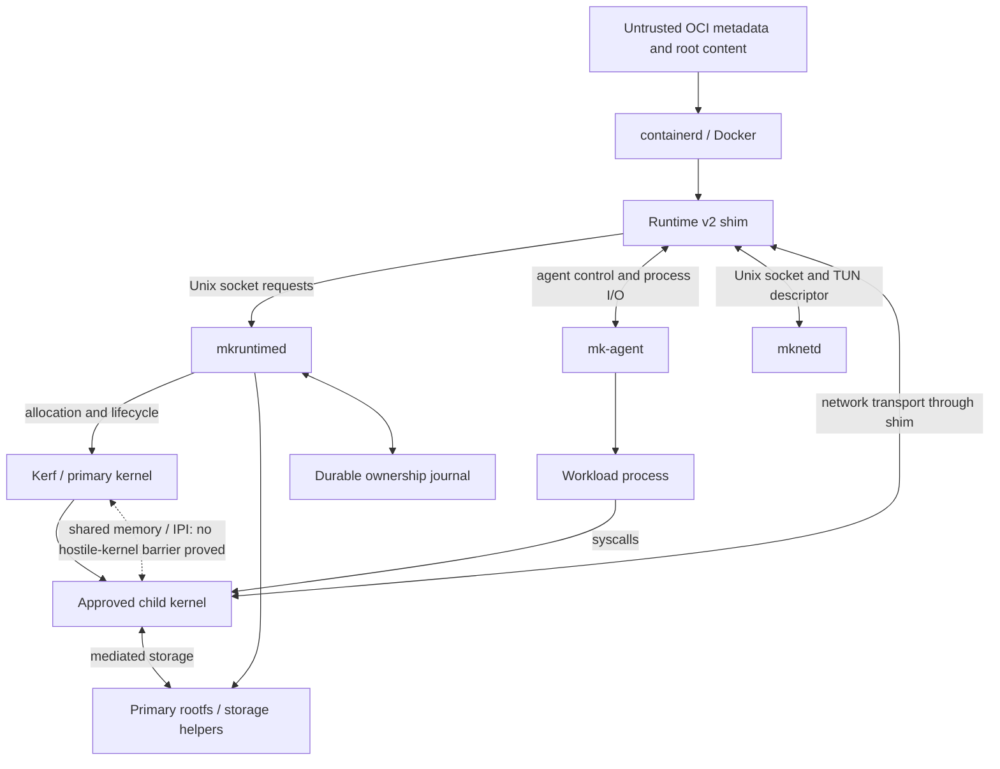

# STRIDE threat model and workload-escape hypothesis

Status: initial model, 2026-10-12, with a
[SEC-01/SEC-02/SEC-11 assessment](g7-security-boundary-assessment.md).
This document does not report a security qualification pass. G7 remains open. The normative
[ownership and trust contract](../contracts/ownership-and-trust.md) and
[pinned G1 isolation audit](g1-pinned-isolation-audit.md) remain authoritative.
The linked assessment distinguishes reproduced source findings, portable tests,
completed live authority checks, remaining remediation, and architectural limitations.

## Motivation and claim to evaluate

The project's security motivation is to give workloads separate Linux kernels
so a compromised workload has a harder path to the primary host. Treat
"harder to escape than gVisor" as a research hypothesis requiring evidence.
Separate boot identities and private roots establish useful separation of
runtime state; they do not establish resistance to malicious kernel execution.

Distinguish three starting conditions:

1. An attacker controls a workload process, including its inputs and syscalls.
2. An attacker obtains workload root or capabilities inside the child. This
   does not automatically mean arbitrary child-kernel execution; accessible
   devices, modules, capabilities, and kernel vulnerabilities decide that step.
3. An attacker obtains arbitrary execution in the child kernel. The current
   trusted-child assumption has failed at this point.

The existing G1 source audit found direct ring-0 child execution, no EPT-style
second-level translation, software-coordinated memory ownership, shared
control memory, and no demonstrated interception of arbitrary APIC, MSR, or
I/O-port access. A hostile child kernel can construct mappings beyond its
assigned E820 regions. Tokens cannot protect secrets from a child kernel
capable of accessing the memory containing them. The exact reachability on a
deployment remains a qualification question; the architecture already blocks
a general hostile-child isolation claim.

Running both kernels inside a GCE VM does not supply an isolation boundary
between those kernels. The cloud hypervisor bounds the VM relative to other
VMs; this project must establish its own boundary inside that VM.

Consequently the present design may redirect workload syscall handling away
from the primary kernel and provide compatibility and cooperative fault
containment. It has not established that exploiting the child Linux kernel
leaves an independently enforced barrier to primary compromise. Using the
same Linux revision in both kernels may also expose correlated vulnerabilities.

## Comparison with gVisor

gVisor implements workload-facing Linux interfaces in its Sentry userspace
application kernel. It constrains the Sentry's host-facing interfaces and uses
helper processes for selected operations. A fair comparison must include
those restrictions rather than treating gVisor as ordinary shared-kernel
containers. See its [security model](https://gvisor.dev/docs/architecture_guide/security/)
and [architecture introduction](https://gvisor.dev/docs/architecture_guide/intro/),
reviewed 2026-10-12. Configuration and platform affect the comparison; pin
them for experiments rather than treating the current docs as a versioned baseline.

| Question | This Multikernel runtime | gVisor comparison baseline |
| --- | --- | --- |
| Workload syscall implementation | Approved child Linux kernel | Sentry's implementation of Linux interfaces |
| Workload-facing implementation exposure | Full configured child Linux surface; reduce and inventory enabled features | Implemented Sentry surface; inventory supported interfaces for pinned release |
| After workload-facing kernel compromise | Hostile child ring-0 execution has no demonstrated hardware barrier to the primary | Compromised Sentry remains subject to its host sandbox restrictions; review helper and host interfaces |
| Host-facing paths | Agent/control transport, shared memory/IPI, mediated storage/network, primary helpers | Restricted host syscalls, helpers, filesystem/network interfaces; configuration dependent |
| Current comparative conclusion | Escape-resistance advantage unproven; compromised-child containment has an architectural gap | Existing design supplies a different defense in depth; no universal ranking inferred |

Evaluate both direct paths through host-facing services and the path through
child-kernel compromise. Counting kernels, counting exploit stages, or timing
one exploit does not establish which design is more secure. A single confirmed
unauthorized host access refutes the corresponding containment claim; a finite
negative test suite supports only its tested scope.

## Method: four questions and STRIDE

Use the [OWASP four-question process](https://cheatsheetseries.owasp.org/cheatsheets/Threat_Modeling_Cheat_Sheet.html):
what are we building, what can go wrong, what will we do about it, and did we
do enough? Apply [Microsoft STRIDE](https://learn.microsoft.com/en-us/azure/security/develop/threat-modeling-tool-threats)
to each process, data store, flow, and boundary crossing. STRIDE categorizes
threats; prioritization and verification are separate project decisions.

Record each threat's starting privileges, reachable interface, asset affected,
mitigation, residual risk, owner, and evidence. Review lifecycle transitions
as well as steady-state flows: identity reuse, rollback, crash recovery, and
cleanup can turn an otherwise valid request into unauthorized resource access.

## Assets, actors, and assumptions

Protect primary and sibling memory, management CPUs, runtime credentials,
approved boot artifacts, primary disks/NIC/controllers, workload roots,
network policy, durable ownership records, host availability, and audit evidence.

For the supported preview, trust the operator, primary kernel, approved child
kernel/initramfs, Kerf, privileged runtime services, and node configuration.
Treat OCI metadata/content, workload-controlled requests, incoming protocol
bytes, identifiers, and stale durable state as untrusted inputs. This model
examines how bugs could violate the trusted-component assumptions; it does not
silently expand the supported preview to hostile tenants.

Actors to examine are a compromised workload process, child root with the
actually granted capabilities, an unauthorized local host user, a malicious
or stale transport peer, and an attacker with child-kernel execution. Primary
administrator compromise is outside containment guarantees. Malicious approved
boot artifacts and dependency compromise are supply-chain risks to inspect.

## Data flows and enforcement boundaries

The arrows show interfaces, not uniformly enforced security boundaries.
Inventory the following boundary checks against the implementation:

| Boundary | Required enforcement or limitation |
| --- | --- |
| OCI input to shim/root preparation | Strict feature rejection, bounded decoding, safe paths, immutable caller snapshot, no caller-controlled privileged hooks |
| Local clients to primary daemons | Socket ownership, peer UID checks, operation authorization, sandbox/generation binding |
| Shim/daemon to agent | Version, token, endpoint, and generation validation; bounded frames; tokens inaccessible to ordinary workload processes |
| Workload to agent/bootstrap | Credentials, process rights, filesystem/device exposure, inherited descriptors; child root access must be measured |
| Child to primary storage/network | Export ownership, request/frame bounds, generation checks, restricted descriptors and routes |
| Journal to reconciliation actions | Validate identity and live ownership before destructive mutations; stale state cannot authorize deletion |
| Child kernel to primary/sibling kernel | Software ownership only at audited revision; no hostile-child memory or platform isolation claim |

## Initial STRIDE threat register

Every row is open for review. Existing regression coverage can be reused after
its exact assertions are mapped; a listed control is a requirement to verify,
not a statement that it is implemented everywhere. Multiple categories can apply.

| ID | STRIDE | Scenario and impact | Control to verify / proposed task |
| --- | --- | --- | --- |
| TM-01 | Spoofing | Wrong UID, stolen token, or stale peer controls a sandbox | Peer authentication and per-operation generation binding; SEC-03 |
| TM-02 | Tampering, elevation | OCI paths, links, mount inputs, or executable arguments redirect a privileged host operation | Descriptor-based path safety, strict OCI policy, bounded subprocesses; SEC-04 |
| TM-03 | Tampering, denial | Malformed frames, lengths, offsets, JSON, or storage requests corrupt state or stall helpers | Decoder/framing validation and bounded allocation/time; SEC-05 |
| TM-04 | Tampering, elevation | Stale journal or racing delete acts on a replacement sandbox's resources | Live identity verification, generation-bound rollback/recovery; SEC-06 |
| TM-05 | Information disclosure, elevation | Workload reads bootstrap tokens, agent state, privileged descriptors, or runtime-owned files | Effective permissions, capabilities, descriptor and mount inventory; SEC-02 |
| TM-06 | Information disclosure, tampering | A child requests another generation's root, block ranges, endpoint, or reconnect | Single-owner exports, bounded ranges, network isolation; SEC-07 |
| TM-07 | Repudiation, disclosure | Missing identity obscures destructive actions, or logs/diagnostics expose credentials | Stable operation records, redaction, bounded collection; SEC-08 and G8 |
| TM-08 | Denial of service | Churn, log pressure, blocked I/O, or malformed peers exhaust primary resources | Primary headroom, quotas, bounded queues/timeouts, leak checks; SEC-09 |
| TM-09 | Elevation, disclosure, tampering | Workload obtains child-kernel execution and crosses software memory ownership | Architectural limitation; source re-audit and bounded canary experiment; SEC-01/SEC-11 |
| TM-10 | Elevation, denial | Compromised primary helper uses unnecessary host privileges | Privilege inventory and isolation of helpers; SEC-10 and G8 |
| TM-11 | Tampering, elevation | Altered kernel/module/initramfs/helper or vulnerable dependency becomes approved code | Pinning, provenance, deployment verification, vulnerability triage; SEC-12 |
| TM-12 | Denial of service | Hostile child controls interrupts/MSRs/I/O or abuses shared CPU/cache/memory resources | Explicit unsupported boundary and architectural decision; SEC-01/SEC-11 |

## Prioritization and closure

Address unauthorized primary/sibling access, privileged host operations,
credential exposure, and cross-generation destruction first. Next address
bounded availability and auditability. Record reachability and impact separately;
do not lower impact because a component is currently assumed trusted.

Threat disposition must be one of verified mitigation, unresolved finding,
accepted risk with named reviewer and rationale, or architectural limitation.
No row is closed solely because an existing happy-path test passes. Freeze
versions and retain exact commands, assertions, failed attempts, findings,
and cleanup under the [evidence contract](../contracts/evidence.md).

The [security task checklist](../plans/g7-security-checklist.md) supplies the
execution backlog. G7 qualification and a gVisor-superiority claim are separate
decisions: passing trusted-preview G7 does not prove hostile-child containment.
